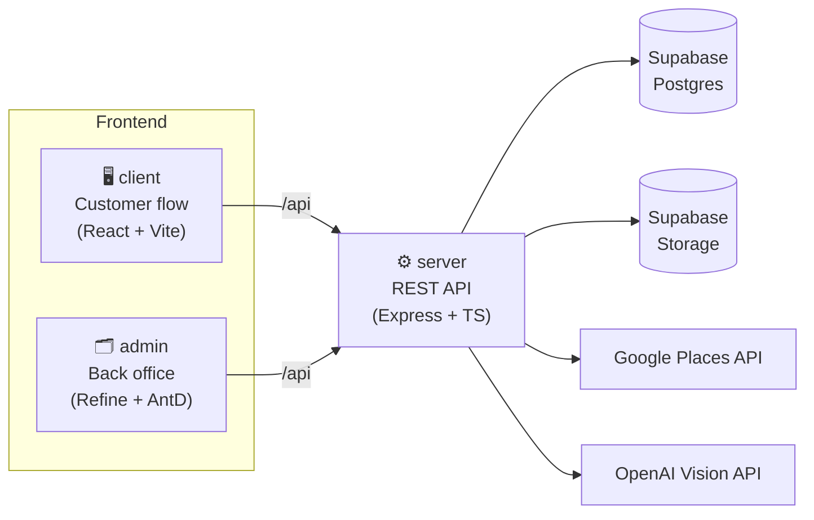

<div align="center">

# 🏠 Instacashly

**Get a fair cash offer on your home in minutes.**

An end-to-end property valuation platform: a guided customer flow, an AI photo inspector, and an internal back office — all in one monorepo.


</div>

---

## 📖 Overview

Instacashly buys houses and land in Dallas–Fort Worth. This repository powers the whole product:

1. A homeowner looks up their **address**, walks through a short **photo + timeline** questionnaire, and gets an **AI-graded, data-backed cash offer** — no realtor, no showings.
2. Every uploaded photo is inspected component-by-component by a **vision model**, which grades condition and feeds directly into the price the customer sees.
3. The internal team manages properties, offers, pricing rules, and photo grading criteria from a dedicated **admin back office**.

## ✨ Features

| | |
|---|---|
| 📍 **Smart address search** | Google Places Autocomplete (New) + Place Details, with a "use my current location" reverse-geocoding fallback — normalized server-side, API key never touches the browser |
| 📸 **Guided photo capture** | Per-component upload (roof, kitchen, bathrooms, floors, exterior paint, windows, doors, landscaping, garage, laundry room, deck) with HEIC→JPEG conversion and automatic WebP optimization before storage |
| 🤖 **AI condition grading** | GPT-4o-mini vision reviews each component's photos, flags irrelevant/low-quality shots, and returns a GOOD / FAIR / BAD / UNKNOWN grade with a reason |
| 💰 **Dynamic offer engine** | Component grades roll up into a condition adjustment on top of a starting value, combined with configurable offer terms (price multiplier, closing window, inspection period) |
| 🧾 **Full offer lifecycle** | Offers are created, tracked through a status history, and can be accepted straight from the customer flow |
| 🗂️ **Admin back office** | Refine + Ant Design CMS for properties, offers, offer terms, grading rubrics, users, and content — no direct database access needed for day-to-day ops |

## 🏗️ Architecture



Every browser-facing app talks **only** to the `server` — third-party API keys (Google, OpenAI, Supabase service key) live exclusively on the backend.

## 📁 Monorepo structure

```
property-valuation-tool/
├── client/          Customer-facing valuation flow (React 19, Vite, Tailwind CSS)
├── admin/           Internal back office (Refine.dev + Ant Design)
├── server/          REST API (Express 5, TypeScript)
│   └── sql/         Database schema, versioned as plain SQL
├── shared/          @pvt/shared — TypeScript types shared across all apps
└── package.json     npm workspaces root — orchestrates dev/build/lint/typecheck
```

## 🧰 Tech stack

| Layer | Technology |
|---|---|
| Customer app | React 19 · Vite · TypeScript · Tailwind CSS · React Router |
| Admin panel | Refine.dev · Ant Design · React 19 |
| API server | Node.js 20+ · Express 5 · TypeScript |
| Data & files | Supabase (Postgres + Storage) |
| Integrations | Google Places API (New) · OpenAI (GPT-4o-mini vision) |
| Image pipeline | Sharp (WebP re-encoding) · heic-convert (iPhone photo support) |
| Tooling | npm workspaces · ESLint · Prettier |

## 🚀 Getting started

### Prerequisites

- Node.js **≥ 20**
- A [Supabase](https://supabase.com) project (Postgres + a Storage bucket)
- A Google Cloud project with **Places API (New)** and **Geocoding API** enabled, billing active
- An [OpenAI](https://platform.openai.com) API key with vision-capable model access

### 1. Install dependencies

```bash
git clone <repo-url>
cd property-valuation-tool
npm install
```

This installs all four workspaces (`client`, `admin`, `server`, `shared`) in one pass.

### 2. Configure environment variables

Each app has its own `.env.example` — copy and fill in real values:

```bash
cp server/.env.example server/.env
cp client/.env.example client/.env
cp admin/.env.example admin/.env
```

<details>
<summary><strong>server/.env</strong></summary>

| Variable | Description |
|---|---|
| `PORT` | API port (defaults to `3001`) |
| `SUPABASE_URL` | Supabase project URL |
| `SUPABASE_SECRET_KEY` | Supabase service-role key (server-only, never exposed) |
| `SUPABASE_BUCKET` | Storage bucket name for property photos |
| `GOOGLE_MAPS_API_KEY` | Backs address search, details, and reverse geocoding |
| `OPENAI_API_KEY` | Used for AI photo condition review |
| `OPENAI_MODEL` | Vision-capable model, e.g. `gpt-4o-mini` |

</details>

<details>
<summary><strong>client/.env & admin/.env</strong></summary>

| Variable | Description |
|---|---|
| `VITE_API_BASE_URL` | Base path for API calls — `/api` in dev (proxied to `server` by Vite) |

</details>

### 3. Run everything locally

```bash
npm run dev
```

Starts `client`, `server`, and `admin` together (via `concurrently`):

| App | URL |
|---|---|
| Customer app | http://localhost:5173 |
| Admin panel | http://localhost:5173/admin *(auto-picks the next free port if 5173 is taken)* |
| API server | http://localhost:3001 |

Or run one at a time: `npm run dev:client`, `npm run dev:server`, `npm run dev:admin`.

### 4. Build for production

```bash
npm run build
```

Builds `server`, `client`, and `admin` in sequence, each into its own `dist/`.

## 🧭 Customer journey

```
Address  →  Photos  →  Timeline  →  Contact  →  Analyzing (AI)  →  Offer  →  Offer accepted
```

Each step is a route under `/addresses/:addressId/...`; a property record is only created once a real, verified address is selected (never from a raw search query).

## 🔌 API surface

All routes are namespaced under `/api`:

| Module | Route | Purpose |
|---|---|---|
| Health | `GET /health` | Liveness check |
| Properties | `POST /properties` | Create a property from a normalized address |
| Addresses | `GET /addresses/search`, `GET /addresses/:placeId`, `GET /addresses/reverse` | Google Places search, details, and reverse geocoding — normalized, US-only |
| Property photos | `POST /property-photos`, `GET /property-photos/property/:propertyId`, `PATCH /:id`, `DELETE /:id` | Upload, list, recategorize, and remove photos |
| AI reviews | `/ai-reviews` | Trigger and fetch AI condition grading |
| Components grade | `/components-grade` | Grade → price-adjustment percentage rubric |
| Offer terms | `/offer-terms` | Price multiplier / closing / inspection configuration |
| Offers | `/offers` | Create, update, and track offer status history |
| Users | `/users` | Customer/lead records |

## 🗄️ Database

Schema is tracked as plain SQL in [`server/sql/`](server/sql/) (no ORM/migration runner) — `001_initial_schema.sql` is the source of truth, with numbered follow-ups for incremental changes. Apply new files by hand against the Supabase project.

## 📜 Useful scripts (repo root)

| Command | What it does |
|---|---|
| `npm run dev` | Run client + server + admin together |
| `npm run build` | Production build of all three apps |
| `npm run lint` / `lint:fix` | Lint (and autofix) every workspace |
| `npm run typecheck` | Type-check every workspace |
| `npm run format` / `format:check` | Prettier across the whole repo |

---

<div align="center">

Built for **Instacashly** · Dallas–Fort Worth

</div>
